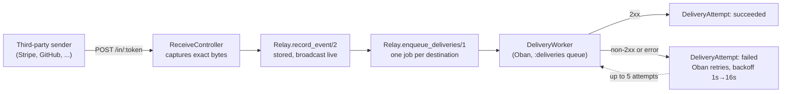

# Hookline

A webhook relay and debugger. Get a receiving URL, point a third-party
service (Stripe, GitHub, anything that sends webhooks) at it, and every
request is captured exactly as sent, forwarded to your real destination
with automatic retries, and visible in a dashboard — including the
headers and body of each one, and a button to replay it. Built for
engineering hiring managers reviewing backend and reliability skills.

[](https://github.com/Nabeel-Siddiqui/hookline/actions)

**Runs locally in under 5 minutes** with seeded demo data. See
[Running it locally](#running-it-locally).

## What it does

- Create an endpoint and get a short, unguessable receiving URL
  (`/in/:token`). No authentication on that URL — the token is the only
  credential a sender has, the same as any real webhook receiving URL.
- Every request is captured exactly as sent: the method, every header,
  and the raw body, byte for byte — not a re-serialized version of it.
- Add one or more destinations, and a captured event is forwarded to
  all of them independently. One destination being down never blocks or
  slows another destination's deliveries for the same event.
- A failed delivery retries automatically, up to 5 times with
  exponential backoff, and every attempt — success or failure, with the
  response code or error — is recorded and visible.
- A dashboard lists endpoints and their events live as they arrive, and
  an event's detail page shows its full headers and body, its delivery
  history, and a Replay button to resend it on demand.
- A body over 256 KB is rejected before it's ever fully read into
  memory, not after.

## Why Elixir for this, specifically

A webhook relay is fundamentally about reliability under failure: a
destination can be slow, down, or flaky, and the relay's job is to keep
trying without losing anything or blocking anything else. That's close
to what the BEAM and OTP are built for.

- **One Oban job per (event, destination) pair, not one job trying to
  deliver to every destination.** Each destination has its own
  independent retry lifecycle — one being down doesn't touch another's
  deliveries for the same event, and Oban's own `max_attempts`/`backoff`
  mechanism is the retry policy, not a hand-rolled loop.
  [ADR 2](docs/decisions/0002-retries-are-obans-own-mechanism.md)
- **The exact bytes a sender posts are what gets captured, replayed,
  and forwarded — never a re-serialization of them.** Phoenix's default
  body parser would otherwise consume and re-decode a JSON payload
  before anything else saw it, which breaks a destination's own
  signature verification on replay.
  [ADR 1](docs/decisions/0001-raw-body-capture.md)
- **A size limit enforced at the read itself, not after the fact.** The
  256 KB cap is checked while the body is being read, so an oversized
  payload is rejected before it's fully buffered into memory, not
  stored and then discarded.
  [ADR 3](docs/decisions/0003-body-size-cap-at-the-read.md)

## Architecture

The path from a captured webhook to a delivered one:



If a destination never succeeds after 5 attempts, Oban discards the
job. Nothing is lost: every attempt is already recorded, and the
dashboard's Replay button runs the exact same `enqueue_deliveries/1`
path on demand.

## Tech stack

Phoenix 1.7 + LiveView · Ecto/Postgres · Oban (deliveries, with
retry/backoff) · Req (forwarding HTTP client, behind a behaviour +
Mox in every test) · Credo (`--strict`) + Dialyzer in CI · GitHub
Actions · Docker (`mix release`).

## Running it locally

Prerequisites: Elixir 1.20.3 / OTP 29.0.5 (see [`Dockerfile`](Dockerfile)
for the versions this was built against) and a local Postgres.

```bash
git clone https://github.com/Nabeel-Siddiqui/hookline.git
cd hookline
mix setup        # deps, DB create + migrate, seeds, assets
mix phx.server
```

Visit `http://localhost:4000` and log in as `demo@hookline.dev` /
`demo-password-please-change`. Two seeded endpoints (Stripe-shaped and
GitHub-shaped events) already have captured events and a delivery
history to look at.

To check the whole thing end to end:

```bash
mix test                # 184 tests, no real network calls
mix credo --strict
mix dialyzer
```

## Design decisions

Three of the less-obvious calls are written up in
[`docs/decisions/`](docs/decisions/), each with the alternative
considered and why it lost:

1. [The exact raw body is captured, not a re-serialized one](docs/decisions/0001-raw-body-capture.md)
2. [Retries are Oban's own mechanism, one job per destination](docs/decisions/0002-retries-are-obans-own-mechanism.md)
3. [The body size cap is enforced at the read, not after](docs/decisions/0003-body-size-cap-at-the-read.md)

`CLAUDE.md` in the repo root has the conventions every phase of this
build held to (contexts own all business logic, the web layer never
touches `Repo` directly, every public context function has `@doc` +
`@spec`, no test ever makes a real network call).

## What I'd do next

- **Signature verification helpers.** The relay forwards a sender's own
  signature header as-is, so a destination's existing verification
  still works — but it doesn't verify the signature itself on the way
  in. A per-endpoint shared secret and signature check would catch a
  forged request before it's even stored.
- **Per-endpoint retry policy.** Every destination currently gets the
  same 5-attempts, doubling-backoff policy. Some integrations want more
  attempts over a longer window; making that configurable per endpoint
  is a natural extension of the existing worker.
- **Filtering and search on the events list.** The dashboard shows every
  event newest-first; filtering by date range, method, or delivery
  status would matter quickly once an endpoint has real volume.
- **A real multi-node run.** The delivery and capture paths don't share
  any node-local state, so they should already work across multiple
  nodes — but, like the rest of this series, that's only ever actually
  run as one node so far.
